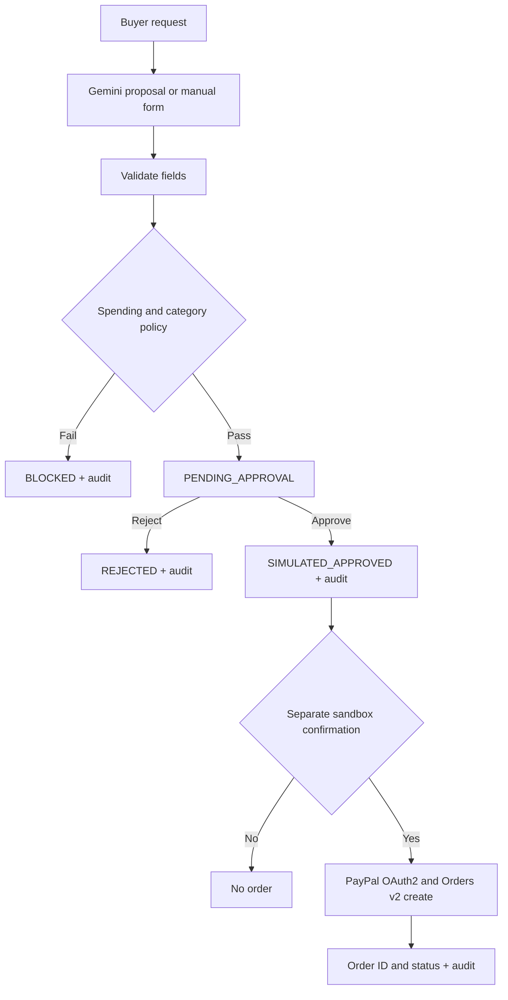

PayPal AgentOps — The Control Plane for Trusted Agentic Commerce
AI proposes. Policy decides. Humans approve. PayPal Sandbox creates the checkout order.

Live demo · YouTube demo · [Screenshot gallery](screenshots/README.md) · [Architecture](docs/ARCHITECTURE.md) · [Devpost description](SUBMISSION_COPY.md) · MIT License
Problem and solution
AI-generated purchase suggestions are not permission to spend. PayPal AgentOps demonstrates how buyer-defined spending limits, human approval, and traceable audit events can govern AI-assisted purchases before a PayPal sandbox checkout order is created.
Implemented features
Feature	Implementation
AI proposal	Google Gemini structured JSON; locally validated
Manual proposal	Streamlit purchase form
Policy	GBP spending limit and approved merchant categories
Buyer review	Simulated explicit approval/rejection
PayPal integration	Sandbox OAuth2, Orders v2 POST create order and GET lookup
Audit	UTC event timestamps, internal proposal ID, PayPal Order ID, JSON export
Interface	Overview, Proposals, Approvals, Audit trail, Architecture, AI + PayPal

Important: A PayPal sandbox order with status CREATED is not a completed payment. The app does not authorize, capture, refund or transfer funds.
Architecture

Read [the architecture document](docs/ARCHITECTURE.md) for security boundaries and limitations.
Screenshots
Browse the [10 application screenshots](screenshots/README.md) showing the PayPal AgentOps demonstration interface.
Local setup
Requires Python 3.12.
git clone https://github.com/Cloud-Architect-Emma/paypal-agentops-hackathon.git
cd paypal-agentops-hackathon
python -m venv .venv
# macOS/Linux: source .venv/bin/activate
# Windows PowerShell: .venv\Scripts\Activate.ps1
python -m pip install -r requirements.txt
python -m unittest discover -s tests -v
python -m streamlit run app.py
Manual policy, buyer decision and audit workflows work without API credentials. Gemini generation and PayPal sandbox operations require credentials.
API configuration
Create .streamlit/secrets.toml locally (excluded by .gitignore) or enter these names in Streamlit Cloud app settings:
GEMINI_API_KEY = "YOUR_OWN_GEMINI_KEY"
PAYPAL_SANDBOX_CLIENT_ID = "YOUR_OWN_SANDBOX_CLIENT_ID"
PAYPAL_SANDBOX_CLIENT_SECRET = "YOUR_OWN_SANDBOX_CLIENT_SECRET"
These are configuration examples, not real keys. Obtain a key from Google AI Studio and sandbox credentials from the PayPal Developer Dashboard. Never commit secrets.
Demo walkthrough
1. Open 05 · AI + PayPal. Enter a request, generate a Gemini proposal, review and submit it to policy.
2. A compliant proposal becomes PENDING_APPROVAL; one exceeding the limit or using an unapproved category is BLOCKED.
3. Open 02 · Approvals. Explicitly approve or reject the proposal (simulation).
4. For an approved proposal, separately confirm PayPal sandbox order creation.
5. Open 03 · Audit trail to inspect timestamped decisions and the returned PayPal Order ID; export JSON.
6. Optionally look up the existing sandbox order status in tab 05.
Example eligible scenario: £49.99 Office Supplies, £100 limit, Office Supplies allowed. Example blocked scenarios: £150 against a £100 limit; Unknown Merchant when not approved.
Repository files
- app.py — Streamlit dashboard and workflow
- engine.py — deterministic policy and audit events
- ai_proposal.py — validation of Gemini proposals
- gemini_proposal.py — structured Gemini API integration
- integrations.py — PayPal sandbox authentication, order creation and lookup
- tests/test_engine.py — unit tests
- docs/ARCHITECTURE.md — architecture and trust boundaries
- screenshots/README.md — gallery of 10 application screenshots
Security and scope
- Sandbox only: no real payments, authorization or capture.
- Gemini cannot bypass policy or directly execute PayPal operations.
- Buyer approval is simulated, not authenticated identity verification.
- Approved merchant categories are not verified sellers.
- Audit records live in Streamlit session state; they are not durable or tamper-evident.
- No real-time streaming, automated alerts or continuous monitoring is implemented.
- PayPal-Request-Id and UI checks reduce accidental duplicates, but there is no durable reconciliation store.
- This is a hackathon proof of concept, not a production payments platform.
Evidence, technology and licence
Browse the [10 application screenshots](screenshots/README.md) and watch the public YouTube demo.

Python 3.12 · Streamlit · Google Gemini API · PayPal Sandbox REST API (OAuth2, Orders v2) · unittest · GitHub Actions · Streamlit Community Cloud.

MIT License © 2026 Emmanuela Opurum.
