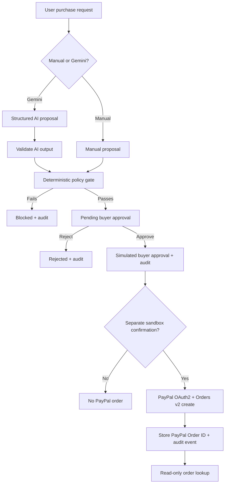

# PayPal AgentOps — The Control Plane for Trusted Agentic Commerce

**AI proposes. Policy decides. Humans approve. PayPal sandbox records the order.**

[Live Streamlit demo](https://paypal-agentops-hackathon-eksknbyjh7w4vc8cjb9yiy.streamlit.app/) · [Source code](https://github.com/Cloud-Architect-Emma/paypal-agentops-hackathon) · [Demo walkthrough](DEMO_SCRIPT.md) · [Architecture](docs/ARCHITECTURE.md)

## The problem

AI shopping agents can recommend purchases, but a recommendation is not permission to spend. Buyers need explicit controls, an approval checkpoint and a traceable record before an agent can initiate a checkout order.

## What AgentOps does

1. **Propose:** A user enters a purchase manually or asks Gemini to produce a structured suggestion.
2. **Validate:** Gemini output is treated as untrusted and validated for supported category, positive GBP amount and description.
3. **Enforce policy:** A deterministic engine checks a configurable spending limit and approved merchant categories. Failed checks are **BLOCKED**.
4. **Require human review:** Passing proposals remain **PENDING_APPROVAL** until the buyer explicitly approves or rejects them.
5. **Create a PayPal sandbox order:** Only after approval and a **second explicit confirmation**, AgentOps calls PayPal Orders v2 to create a sandbox checkout order. It does **not** authorize, capture or transfer funds.
6. **Explain and audit:** The application records timestamped events and associates the AgentOps proposal ID with the PayPal sandbox Order ID. An existing sandbox order's status can be retrieved read-only.

## Working capabilities

| Capability | Implementation |
| --- | --- |
| AI purchase proposal | Gemini API; structured output and local validation |
| Policy gate | Deterministic Python spending-limit and category checks |
| Buyer control | Explicit simulated approval or rejection |
| Sandbox checkout | PayPal OAuth2 and Orders v2 create-order API, after separate confirmation |
| Order lookup | Read-only PayPal Orders v2 GET |
| Audit | UTC event timestamps, decision explanations, linked proposal and PayPal order IDs; JSON export |
| UI | Five-tab Streamlit app |

### Demo scenarios

- **£49.99, Office Supplies, £100 limit, category approved:** policy passes → buyer approves → separate sandbox-order confirmation → PayPal order ID logged.
- **£150, Office Supplies, £100 limit:** blocked by spending policy.
- **£30, Unknown Merchant, category not approved:** blocked by merchant-category policy.
- **Buyer rejects an eligible proposal:** rejected; no PayPal order is created.

## Quick start

Requirements: Python 3.10+ and network access for optional external API calls.

```bash
git clone https://github.com/Cloud-Architect-Emma/paypal-agentops-hackathon.git
cd paypal-agentops-hackathon
python -m venv .venv
# macOS/Linux: source .venv/bin/activate
# Windows PowerShell: .venv\Scripts\Activate.ps1
python -m pip install -r requirements.txt
python -m unittest discover -s tests -v
python -m streamlit run app.py
```

The **manual proposal, policy, approval and audit** workflows work without API credentials. Gemini and PayPal integrations require their own credentials.

## Configure API credentials (never commit secrets)

For local development, create `.streamlit/secrets.toml` (this path is gitignored):

```toml
GEMINI_API_KEY = "YOUR_GEMINI_API_KEY"
PAYPAL_SANDBOX_CLIENT_ID = "YOUR_PAYPAL_SANDBOX_CLIENT_ID"
PAYPAL_SANDBOX_CLIENT_SECRET = "YOUR_PAYPAL_SANDBOX_CLIENT_SECRET"
```

Get a Gemini API key from Google AI Studio and **sandbox** REST API credentials from the PayPal Developer Dashboard. On Streamlit Community Cloud, set these three keys in the app's **Settings → Secrets** instead. Restart the app after changing secrets. Do not enter production PayPal credentials.

### Walk through the app

1. Open **01 · Agent proposal** and submit a purchase with a limit and approved categories, or use **05 · AI + PayPal sandbox** to request a Gemini proposal.
2. Open **02 · Buyer decision** to review the policy-passing proposal and explicitly approve it.
3. In the same tab, confirm **Create PayPal sandbox order (no capture)**. This is a distinct action and requires configured PayPal sandbox credentials.
4. Open **03 · Audit trail**. Expand the proposal to view the PayPal Order ID, order status and timestamped `PAYPAL_SANDBOX_ORDER_CREATED` event. Export the record as JSON.
5. Use **05 · AI + PayPal sandbox** to look up an existing sandbox Order ID without executing a payment.

**Note:** `DEMO-XXXXXXXX` is an internal AgentOps proposal ID, not a PayPal Order ID. A PayPal sandbox Order ID is assigned only after successful sandbox order creation.

## Architecture



See [architecture and trust boundaries](docs/ARCHITECTURE.md).

## Security, limitations and honest scope

- **Sandbox only.** The Orders v2 payload specifies `intent: CAPTURE`, but **creating** an order does not capture a payment. There is no authorization, capture, refund or transfer operation in this demo.
- **No autonomous payment authority.** Gemini cannot approve, override policy or directly invoke PayPal checkout.
- **Approval is simulated.** No authenticated buyer identity, verified merchant identity or production-grade authorization is implemented. Approved categories are not verified sellers.
- **Session-only history.** Streamlit session state is not a persistent audit database; a session reset clears the records.
- **Idempotency scope.** Order creation sends `PayPal-Request-Id` derived from the proposal ID and the UI guards against recreating a linked order. This is not a substitute for a durable idempotency store in production.
- **Secrets.** Credentials belong in Streamlit secrets, never in GitHub or screenshots. A hosted public demo may require the app owner's configured server-side keys for the external features to be usable.
- This is a **hackathon MVP**, not a production payments or compliance platform.

## Screenshots

Screenshots will be added under [`screenshots/`](screenshots/) after capturing the live app. See [screenshot checklist](screenshots/README.md). No simulated screenshots are presented as live evidence.

## Tech stack

Python · Streamlit · Google Gemini API · PayPal Sandbox REST API (OAuth2, Orders v2) · Python `unittest`

## License

[MIT License](LICENSE) © 2026 Emmanuela Opurum.
