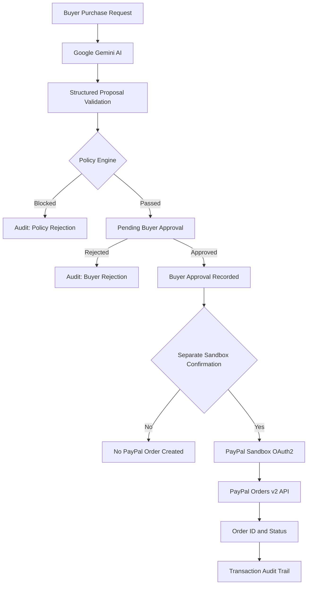

# PayPal AgentOps — System Architecture

## 1. Overview

PayPal AgentOps is a governance and observability control plane for AI-assisted commerce.

It combines Google Gemini, a deterministic policy engine, human-in-the-loop approval, PayPal Sandbox APIs and explainable transaction audit events.

**Core principle:** AI proposes. Policy decides. Humans approve. PayPal Sandbox creates the checkout order.

## 2. End-to-End Architecture

## 3. Architecture Components

### AI Proposal Layer

- Google Gemini generates structured purchase proposals.
- The proposal contains a merchant category, estimated GBP amount and description.
- AI output is validated before policy evaluation.
- Gemini cannot independently approve or execute payments.

### Policy Enforcement Layer

- Evaluates spending limits.
- Checks approved merchant categories.
- Blocks requests that violate configured policies.
- Produces explainable decisions.

### Human Approval Layer

- Displays eligible purchase proposals for review.
- Allows the buyer to approve or reject proposals.
- Records the decision.
- Requires a separate confirmation before PayPal sandbox order creation.

Buyer approval is simulated and does not constitute authenticated payment authorisation.

### PayPal Integration Layer

Uses the PayPal Sandbox REST API:

- OAuth2 authentication.
- Orders v2 create-order endpoint.
- Orders v2 read-only order-status endpoint.
- Links the PayPal Order ID to the internal AgentOps proposal.

The prototype does not capture, authorise or transfer funds.

### Audit and Observability Layer

Records:

- Agent proposal creation.
- Policy evaluation and decision.
- Buyer approval or rejection.
- PayPal sandbox order creation.
- Associated PayPal Order ID and status.
- UTC event timestamps.

Audit records can be exported as JSON.

## 4. Security and Trust Boundaries

1. AI cannot bypass deterministic policy enforcement.
2. A policy-approved proposal still requires human review.
3. Human approval does not automatically create a PayPal order.
4. A separate confirmation is required for sandbox order creation.
5. PayPal API credentials are stored in Streamlit secrets.
6. All payment-related API operations use the sandbox environment.

## 5. Technology Stack

| Layer | Technology |
|---|---|
| User interface | Python Streamlit |
| AI generation | Google Gemini API |
| Policy enforcement | Python |
| Buyer approval | Streamlit workflow |
| Payment integration | PayPal Sandbox REST API |
| Authentication to PayPal | OAuth2 client credentials |
| Audit events | Streamlit session state |
| Source control | GitHub |
| Deployment | Streamlit Community Cloud |

## 6. Current Limitations

This is a hackathon proof of concept, not a production payment platform.

- Audit records are session-based rather than permanently stored.
- There is no continuous transaction monitoring or automated alerting.
- Buyer identities are not independently authenticated.
- Merchant categories are not verified merchant identities.
- No real payments, captures or transfers occur.
- Audit records are not cryptographically tamper-evident.

## 7. Future Enhancements

- Persistent transaction audit storage.
- Real-time transaction monitoring.
- Risk scoring and anomaly detection.
- Automated compliance alerts.
- Enterprise policy administration.
- Authenticated buyer approvals.
- Centralised observability dashboards.
- Production-grade access control and audit integrity.

## 8. Conclusion

PayPal AgentOps demonstrates how AI-generated purchase requests can be governed through deterministic policy checks, human approval and traceable PayPal sandbox order creation.

It provides a foundation for a more comprehensive governance and observability platform for agentic commerce.
